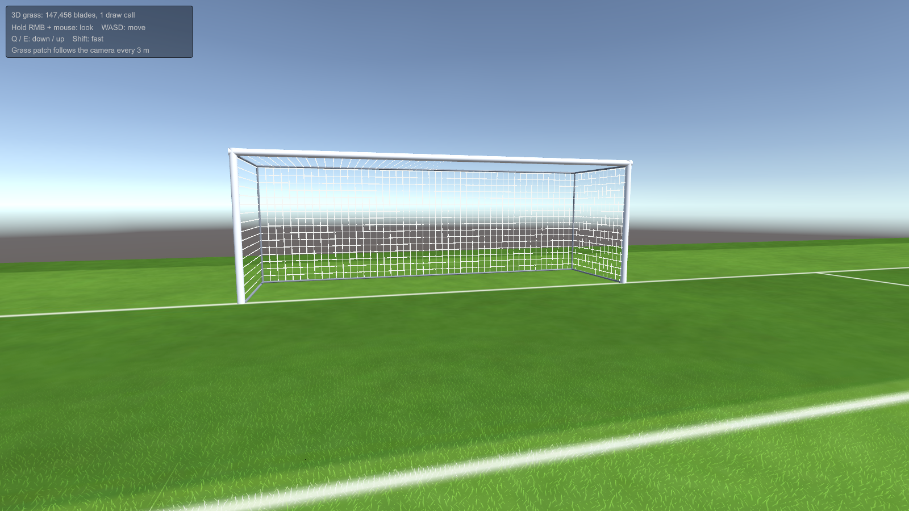
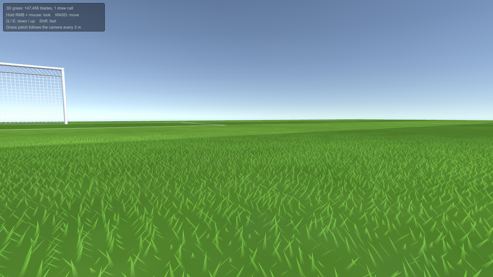
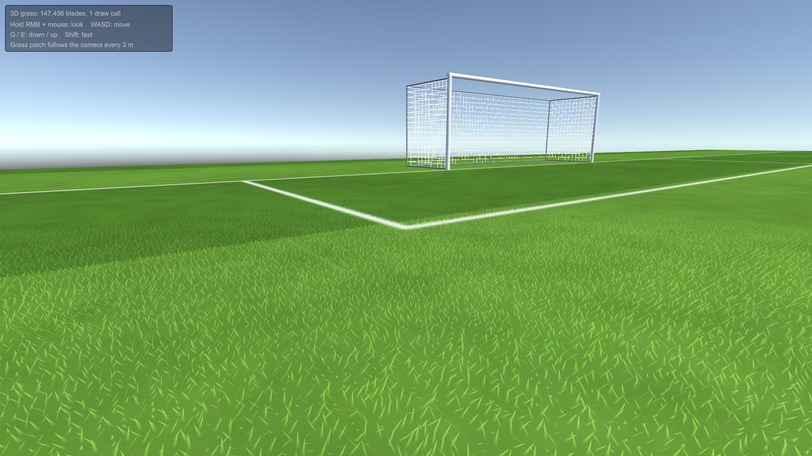
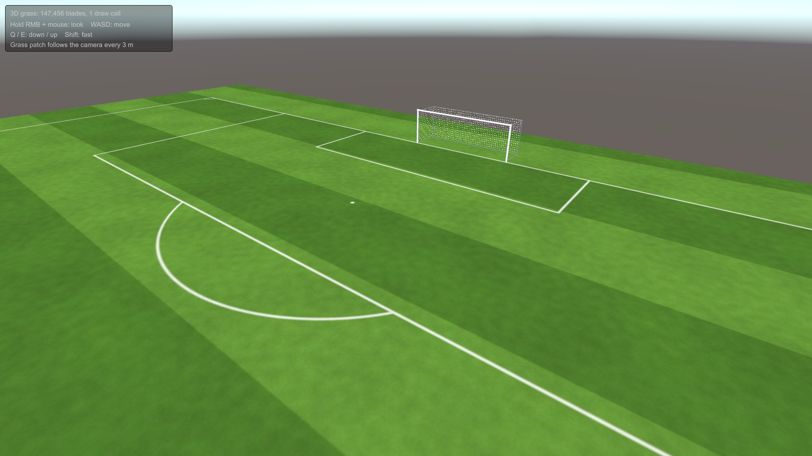

# Stadium Grass – coding sample

GPU-driven 3D grass for a football pitch, taken from my VR football game **Goal Poacher** (Meta Quest / PC VR)
and packaged as a small standalone Unity 6 demo.

| Close up | Line markings become white blades |
|---|---|
|  |  |

From high up, the 3D blades are too small to see, and everything outside the patch near the camera is the flat textured plane:

## What is the sample

The code under review is in [`Assets/GrassRendering`](Assets/GrassRendering). These files are copied from the
game unchanged (byte for byte):

| File | Role |
|---|---|
| [`GrassSystem.cs`](Assets/GrassRendering/GrassSystem.cs) | Builds the blade buffers, drives the compute kernels, issues the draw |
| [`ComputeGrass.compute`](Assets/GrassRendering/ComputeGrass.compute) | `CSColoring` (color blades from the pitch) and `CSCulling` (per-frame view culling) |
| [`OneGrassUnlitShader.shader`](Assets/GrassRendering/OneGrassUnlitShader.shader) | Vertex-pulling shader that reads the buffers by `SV_VertexID` |

Everything in [`Assets/Demo`](Assets/Demo) is scaffolding written for this repository: a pitch, a goal, a fly
camera, and three small shims (`GlobalReference`, `PlayerGP`, `QuestQualityManager`) that stand in for the
game classes `GrassSystem` refers to, so it compiles without modification.

## How it works

The pitch is a flat, cheap, textured plane. Around the player, a 12 m × 12 m patch of
**384 × 384 = 147,456 real 3D blades** is drawn on top of it, in **one draw call with no mesh**.

1. **Blades are built once.** `Init()` creates one triangle per blade from a template blade (`GrassOne` and
   its three points), with a Perlin-noise rotation and tip offset. It uploads them to a `ComputeBuffer` and
   never touches them again. Blades are shortened with distance from the patch center, so the patch fades
   into the flat pitch instead of ending in a hard edge.
2. **Blades take their color from the pitch.** An orthographic camera looks straight down and renders only
   the `Field` layer into a 384² render texture, which is one texel per blade. The `CSColoring` kernel turns
   that snapshot into per-vertex colors, with the tip brightened toward the center of the patch. Mowing
   stripes and white line markings therefore carry over into the 3D grass automatically. Black texels (no
   field) give alpha 0, and the vertex shader collapses those blades.
3. **Culling on the GPU.** Each frame, `CSCulling` tests every blade against the camera's forward direction
   and two vectors rotated ±30°. Blades that fail are collapsed to a degenerate vertex in the shader.
4. **Each pixel is shaded at most once.** The grass shader uses a stencil test (`Ref 0, Comp Equal, Pass IncrWrap`):
   the first blade to cover a pixel claims it, and later blades behind it are rejected before shading.
   On mobile VR this keeps the overdraw cost of 150k overlapping thin triangles under control.
5. **Following the player costs almost nothing.** Blade positions are stored relative to the patch, and the
   shader adds `_RootPos`. To move the patch, the code only moves the snapshot camera, renders one 384²
   frame and dispatches `CSColoring` once. No vertex data is uploaded again.
6. **Initialization is spread over frames.** `Init()` / `RefreshGrassPosition()` are `async UniTask`
   methods that spread the work across frames, so the loading screen does not hitch on Quest.

## Running

- Unity **6000.3.18f1**, Built-in Render Pipeline, Linear color space.
- [UniTask](https://github.com/Cysharp/UniTask) is pulled in by Package Manager (git URL in `Packages/manifest.json`).
- Open `Assets/Demo/Scenes/StadiumGrassDemo.unity` and press Play.

Controls: hold right mouse button + mouse to look, WASD to move, Q / E to go down / up, Shift to move faster.
When the camera moves 3 m, the grass patch is rebuilt around it.

In the Editor the grass is drawn from `OnRenderObject`. In a player build it is drawn with
`Graphics.DrawProcedural` (this is the game's own split).

`Tools > Stadium Grass Demo > Rebuild Everything` regenerates the pitch texture, the goal net, the materials,
the scene and the `GrassSystem` prefab from code ([`DemoSceneBuilder.cs`](Assets/Demo/Editor/DemoSceneBuilder.cs)).
The screenshots above come from a player build run with `StadiumGrassDemo.exe -capture <folder>`.
