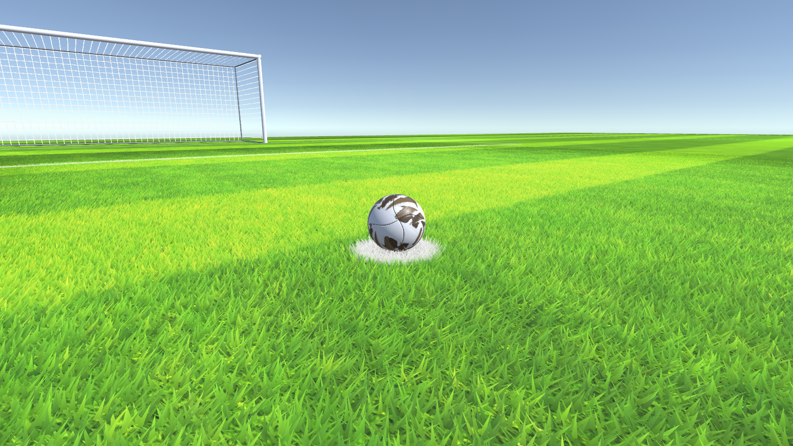
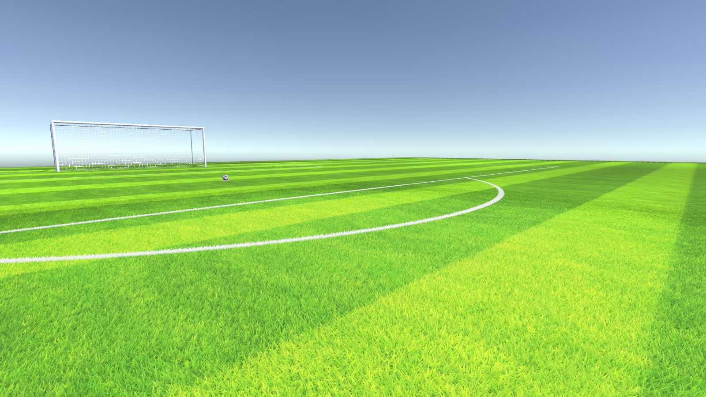
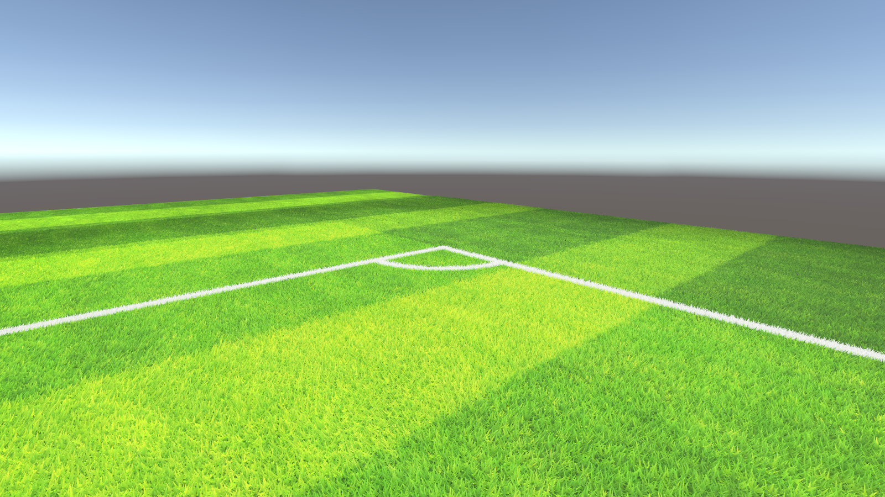

# PitchBlade

**Procedural, compute-based soccer grass for Unity.** Coding sample from Goal Poacher (Meta Quest).

The 3D grass system from my VR football game **Goal Poacher**, shipping on **Meta Quest**: a mobile GPU that
renders every frame twice, once per eye. Every blade of grass is real geometry, and the whole patch is drawn
in **a single draw call**.

On Quest the patch has **147,456 blades** (384 × 384). This PC demo pushes it to **1.3 million** (1152 × 1152).

> **The code sample is three files in [`Assets/GrassRendering/`](Assets/GrassRendering):**
> [`GrassSystem.cs`](Assets/GrassRendering/GrassSystem.cs),
> [`ComputeGrass.compute`](Assets/GrassRendering/ComputeGrass.compute) and
> [`OneGrassUnlitShader.shader`](Assets/GrassRendering/OneGrassUnlitShader.shader).
> Everything else in the repository is the demo built around them.

| Close up | Line markings become white blades |
|---|---|
|  |  |

| Penalty box | Penalty arc |
|---|---|
|  |  |

## The code

The sample is the three files in [`Assets/GrassRendering`](Assets/GrassRendering). I wrote them by hand in
**December 2024**, before AI coding assistants were any good.

| File | Role |
|---|---|
| [`GrassSystem.cs`](Assets/GrassRendering/GrassSystem.cs) | Builds the blade buffers, drives the compute kernels, issues the draw |
| [`ComputeGrass.compute`](Assets/GrassRendering/ComputeGrass.compute) | `CSColoring` (color blades from the pitch) and `CSCulling` (per-frame view culling) |
| [`OneGrassUnlitShader.shader`](Assets/GrassRendering/OneGrassUnlitShader.shader) | Vertex-pulling shader that reads the buffers by `SV_VertexID` |

I have not had time to refactor it into something pretty, so it is shown as it ships. What it is built for is
speed on Meta Quest:

- **One draw call** for the whole patch. No mesh, no instancing.
- **The vertices live on the GPU.** Every blade is built once at load and uploaded to a `ComputeBuffer`;
  the CPU never touches them again.
- **Per frame, only a compute shader runs**, to update what the camera can see.
- **GPU culling**: blades outside the view are collapsed before they cost anything to draw.
- **Fade with distance**: blades shorten towards the edge of the patch and blend into the flat pitch.

Differences from the game: `numberOfGrassBladePerRow` and `cameraGrassResolution` in `GrassSystem.cs` are
raised from 384 (the Quest value) to 1152 for this demo (9× more blades), and comments that were not in English, along with
old commented-out code, have been removed.

## How it works

The pitch is a flat, cheap, textured plane. Around the camera, a 12 m × 12 m patch of real 3D blades is drawn
on top of it: **384 × 384 = 147,456 blades** on Quest (one every 3.1 cm), **1152 × 1152 = 1,327,104** in
this demo (one every 1 cm).

1. **Blades are built once.** `Init()` creates one triangle per blade from a template blade (`GrassOne` and
   its three points), with a Perlin-noise rotation and tip offset, and uploads them to a `ComputeBuffer`.
   Blades are shortened with distance from the patch center, so the patch fades into the flat pitch instead
   of ending in a hard edge.
2. **Blades take their color from the pitch.** An orthographic camera looks straight down and renders only
   the `Field` layer into a render texture with one texel per blade. The `CSColoring` kernel turns that
   snapshot into per-vertex colors, with the tip brightened toward the center of the patch. Mowing stripes
   and white line markings carry over into the 3D grass with no extra work. Black texels (no field, or the
   cut-off edges on the `GrassCamLine` layer) give alpha 0, and the vertex shader collapses those blades.
3. **Culling on the GPU.** Each frame, `CSCulling` tests every blade against the camera's forward direction
   and two vectors rotated ±30°. Blades that fail are collapsed to a degenerate vertex in the shader.
4. **Each pixel is shaded at most once.** The grass shader uses a stencil test (`Ref 0, Comp Equal, Pass IncrWrap`):
   the first blade to cover a pixel claims it, and the blades behind it are rejected before shading. This
   keeps the overdraw of many thin, overlapping triangles under control on a mobile GPU.
5. **Moving the patch is cheap.** Blade positions are stored relative to the patch, and the shader adds
   `_RootPos`. To move the patch, the code moves the snapshot camera, renders one frame and dispatches
   `CSColoring` once. No vertex data is uploaded again.
6. **No loading hitch.** `Init()` and `RefreshGrassPosition()` are `async UniTask` methods that spread their
   work across frames, so the loading screen does not stutter on Quest.

## Limitations

Known limits of the code as it ships:

- **The patch does not follow a moving camera smoothly.** Each blade's shape (rotation, lean, length fade) is
  baked in `Init()` relative to the patch center. When the patch moves, the blade on a given spot of the pitch
  becomes a different blade, and while the move is in progress (`isRefreshingGrass`, 3–4 frames) the grass is
  not drawn. The game only moves the patch on camera cuts, behind a fade to black, and so does the demo.
- **Only a 12 m × 12 m patch is 3D.** Everything else is the flat pitch texture.
- **Colors are a snapshot.** The grass camera only renders when the patch moves, so something moving on the
  `Field` layer does not update the blade colors until the next move.
- **Coarse culling.** `CSCulling` only tests three half-spaces (camera forward and ±30°). There is no
  frustum, distance or LOD culling, so every blade is processed every frame.
- **Unlit, static grass.** No lighting, no shadows (except what the snapshot sees), no wind.
- **Requires compute shaders.** There is no fallback path.
- **`Init()` builds the blades on the CPU**, which takes a few seconds at load with 1.3 M blades.

## The demo around it

Everything in [`Assets/Demo`](Assets/Demo) is scaffolding for this repository, not part of the sample:

- from Goal Poacher: the pitch mesh, its grass shader and the grass texture of the Beach stadium
  (`Assets/Demo/GoalPoacherPitch`), and a ball skin (`Assets/Demo/GoalPoacherBall`);
- written for the demo: line markings, goal and net, the camera that loops through the viewpoints, the
  screenshot capture, the scene builder, and three small shims (`GlobalReference`, `PlayerGP`,
  `QuestQualityManager`) that stand in for the game classes `GrassSystem` refers to. These code files start
  with a comment saying they were generated with AI.

## Running

- Unity **6000.3.18f1**, Built-in Render Pipeline, Linear color space.
- [UniTask](https://github.com/Cysharp/UniTask) is pulled in by Package Manager (git URL in `Packages/manifest.json`).
- Open `Assets/Demo/Scenes/StadiumGrassDemo.unity` and press Play.

The camera loops through three viewpoints, a few seconds each. Left / Right (or Space, or 1–3) switch views,
and P turns the loop on and off. Each switch fades to black, moves the camera, rebuilds the grass patch in
front of it and fades back in.

In the Editor the grass is drawn from `OnRenderObject`; in a player build it is drawn with
`Graphics.DrawProcedural` (this is the game's own split).

`Tools > Stadium Grass Demo > Rebuild Everything` rebuilds the scene from code
([`DemoSceneBuilder.cs`](Assets/Demo/Editor/DemoSceneBuilder.cs)). The screenshots above come from a player
build run with `StadiumGrassDemo.exe -capture <folder>`.

## License

[MIT](LICENSE) © 2024 Tran Dang Duc
